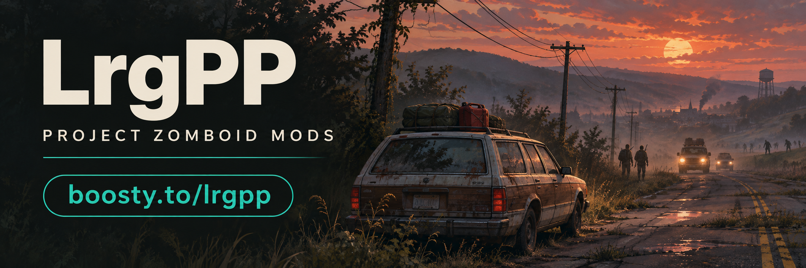

# [OBSOLETE - Merged into Caravans] A-Life: Airwaves & Contracts [B42]

> ## ⚠️ OBSOLETE — MERGED INTO [A-LIFE: CARAVANS v0.8.0](https://steamcommunity.com/sharedfiles/filedetails/?id=3829571361)
> **Project A-Life 1.5** now includes its own native radio events and missions, and the unique features of this add-on (**calling a caravan by radio, ordering roadside supply drops, and requesting town market & road intel summaries on `101.6 MHz`**) have been **fully merged into [A-Life: Caravans v0.8.0](https://steamcommunity.com/sharedfiles/filedetails/?id=3829571361)**.
>
> For existing subscribers, version `0.1.1` of `ALifeAirwaves` is a **safe no-op** (`[ALA] Obsolete: merged into A-Life: Caravans 0.8.0`): it spawns nothing and installs no hooks on top of Project A-Life 1.5 or Caravans 0.8.0, so your existing saves will not break. You can safely unsubscribe or disable this mod and use **[A-Life: Caravans v0.8.0](https://steamcommunity.com/sharedfiles/filedetails/?id=3829571361)** instead.

[Steam Workshop (3836487758)](https://steamcommunity.com/sharedfiles/filedetails/?id=3836487758) · [Get A-Life: Caravans v0.8.0](https://steamcommunity.com/sharedfiles/filedetails/?id=3829571361) · [Русский](README_RU.md)

## My mods

- [SmoothRide MP](https://steamcommunity.com/sharedfiles/filedetails/?id=3827367565)
- [ZombieSync MP](https://steamcommunity.com/sharedfiles/filedetails/?id=3827946115)
- [Tripping Zombies MP Fix](https://steamcommunity.com/sharedfiles/filedetails/?id=3829034899)
- [Wandering Hordes Performance Fix](https://steamcommunity.com/sharedfiles/filedetails/?id=3829140377)
- [Download Unstuck](https://steamcommunity.com/sharedfiles/filedetails/?id=3829163351)
- [A-Life: Caravans](https://steamcommunity.com/sharedfiles/filedetails/?id=3829571361)

© 2026 druidqwerty. Released under the MIT License. Project A-Life by Vice.
